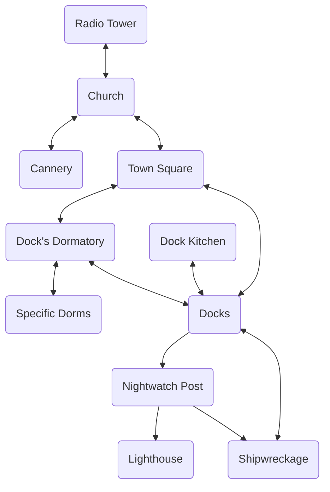

# Abstract
This session will be the maiden voyage for Squad Three. A [[CASTLE]] enlistment of prisioners whom possess a [[Sin Seed]] for the purposes of fighting the stain and exorcising sin. This session will take our group to Gaspé Bay for the exterminiation of [[GH-01]], "GRENDEL", an OGRE class (CAT 1, Type 1) sin. 

# ![[GBPOI|Points of Interest]]

- Père Julien Monreau
- Theodore Landry
- Marc Fortin
- Alain Leblanc
- Normand Bouchard
- Simone Bouchard
- Luc Roy
- Denis Fortin
- Laurence Gunther
- Helene Rousseau
- Isabelle Morin
- Abbe Faria